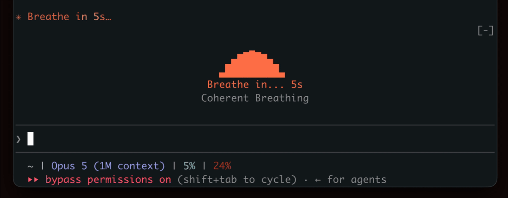

# claude-breathe

Breathe while Claude works.

Every prompt you send gives you 10 to 60+ seconds of waiting. This Claude Mod turns that time into a guided breathing exercise. When Claude starts working, a breathing animation appears above the prompt and the spinner counts the breath with you. When Claude answers, it's gone.



## Why

Slow breathing at about 5.5 breaths per minute raises heart rate variability (HRV), a marker of stress resilience. Even short sessions lower cortisol and sharpen focus. Every Claude turn becomes a micro-session, and you never leave the terminal.

## Styles

Seventeen animation styles ship with this fork. The first four are the originals; the rest were added here. All of them are drawn from plain text — no images, no assets — as pure functions of the breath, and most of them of time as well.

**Original**

| Style | Looks like |
|---|---|
| `pulse` | block bars growing out from the middle |
| `ripples` | dashed horizontal ripples widening with the breath |
| `dots` | a starburst of dots revealing outwards |
| `wave` | filled block hills rising and falling |

**Added in this fork**

| Style | Looks like | Moves with |
|---|---|---|
| `sine` | a braille sine wave spreading from the middle to both sides | breath |
| `bloom` | a six-petal flower opening and closing | breath |
| `bubble` | bubbles rising, more and larger as the lungs fill | time + breath |
| `heartbeat` | an ECG trace scrolling past, one beat a second | time + breath |
| `orbit` | a dotted ellipse with three dots circling it | time + breath |
| `spiral` | an Archimedean spiral winding out while it turns | time + breath |
| `lissajous` | a 3:2 Lissajous curve morphing as it drifts | time + breath |
| `rain` | diagonal rain, denser as the lungs fill | time + breath |
| `equalizer` | a spectrum of bars dancing, taller with the breath | time + breath |
| `aurora` | a thin ribbon of light with short rays where it glows | time + breath |
| `circuit` | dashed buses and nodes with pulses running along them | time + breath |
| `snow` | flakes drifting down with a slow sideways sway | time + breath |
| `melody` | notes flowing along three staff lines | time + breath |

`/breathe style random` picks one per turn and never repeats the one just shown.

## Install

Needs Claude Code 2.1.269 or later. Claude Mods are in early access, so turn them on in `~/.claude/settings.json`:

```json
{
  "env": {
    "CLAUDE_CODE_ENABLE_FUNCTION_HOOKS": "1"
  }
}
```

Then:

```sh
claude plugin marketplace add linxuan-sys/claude-breathe
claude plugin install breathe@claude-breathe
```

Start `claude`, send a prompt, breathe.

To remove it: `claude plugin uninstall breathe`.

## `/breathe`

| Command | What it does |
|---|---|
| `/breathe` | Show the current settings |
| `/breathe off` / `on` | Hide or show the band |
| `/breathe hrv` | Coherent Breathing: 5.5s in, 5.5s out |
| `/breathe sigh` | Physiological Sigh: double inhale, long exhale |
| `/breathe box` | Box Breathing: 4s in, 4s hold, 4s out, 4s hold |
| `/breathe 478` | 4-7-8 Breathing: 4s in, 7s hold, 8s out |
| `/breathe style <name>` | Pin a style — any name in the tables above, or `random` |
| `/breathe delay 5` | Seconds into a turn before the band appears (default 0) |
| `/breathe spinner off` | Leave the spinner alone |

Settings persist across sessions.

| Exercise | Best for |
|---|---|
| **Coherent Breathing** | Sustained HRV improvement |
| **Physiological Sigh** | Quick calm-down |
| **Box Breathing** | Focus and concentration |
| **4-7-8 Breathing** | Deep relaxation |

## How it works

A [Claude Mod](https://github.com/anthropics/claude-code/issues/91870) is a plugin whose hooks are TypeScript functions running inside Claude Code. This one costs zero tokens: the model never sees it.

- `hooks/register.tsx` hooks `ui.render` for the band above the prompt and mounts the animation while the engine says a turn is working. It also rewrites the spinner's word with the current phase and registers `/breathe`.
- `hooks/breathe.tsx` is the animation, drawn ten times a second on the surface's own clock. It passes the elapsed time into the frame too, so the styles that flow can keep moving while a breath holds.
- `hooks/breath/` holds the exercises, easing and all seventeen shapes as pure functions, covered by `bun test`.

The animation styles live in `hooks/breath/shapes.ts`. Each one is a function that turns the breath's progress (0–1000) and, where it needs it, the elapsed time into rows of text: braille dots, block elements, box drawing or symbols. Adding a style is a local change there plus its name in `STYLES`.

## Develop

```sh
git clone https://github.com/linxuan-sys/claude-breathe
cd claude-breathe
claude --plugin-dir .      # loads from disk, hot-reloads on save
bun test
```

For type checking, run `/plugin-types` in that session, then `bunx -p typescript tsc -p .`.

The original bash and tmux version lives in [`legacy/`](legacy/).

## Credits

`claude-breathe` is a fork of [Mindful-Claude](https://github.com/halluton/Mindful-Claude) by [Anthony](https://github.com/halluton), released under the MIT license. The breathing engine, the four exercises and the four original styles are his work. The thirteen additional styles, the elapsed-time frame path that lets them flow, and this packaging were added by [Linxuan](https://github.com/linxuan-sys). Thank you, Anthony.

## License

MIT. See [LICENSE](LICENSE), which keeps the original copyright notice alongside this fork's.
